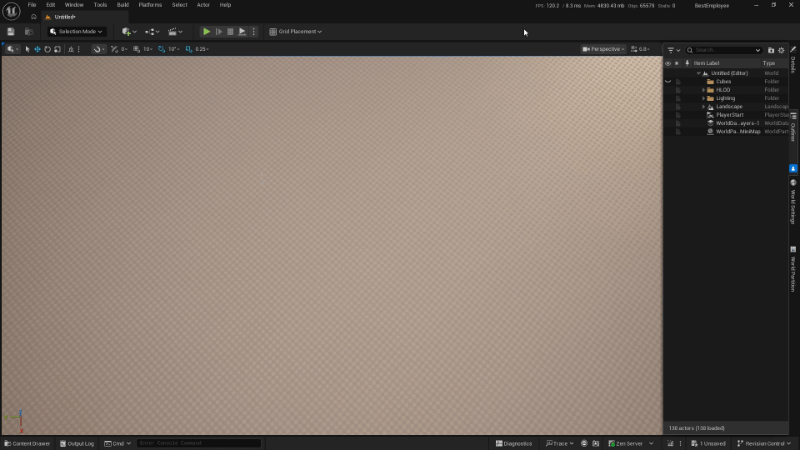
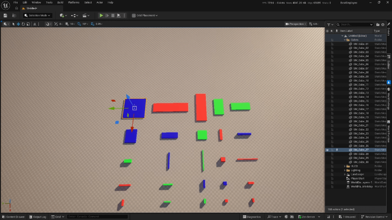
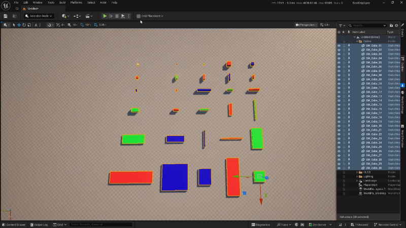
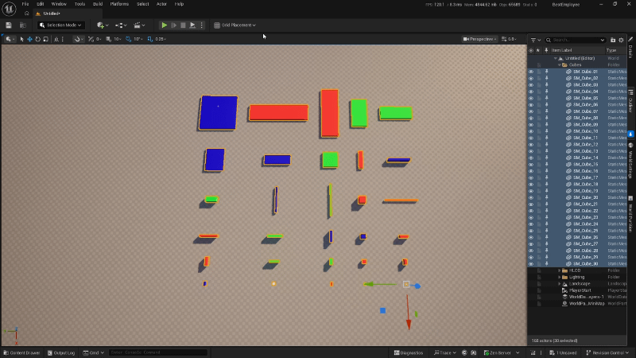

# GridPlacementTool

An Unreal Engine 5.8 editor plugin that arranges selected scene actors or Content Browser assets on a grid in a single plane. It is aimed at technical artists who need to inspect and validate assets: lay out a batch in a compact grid to compare silhouettes, scale and materials.

The tool changes only location and rotation, actor scale is preserved.

## Table of Contents

- [Requirements and installation](#requirements-and-installation)
- [Menu reference](#menu-reference)
  - [Settings](#settings)
  - [Anchor](#anchor)
  - [Sorting](#sorting)
  - [Size-based spacing](#size-based-spacing)
  - [Place](#place)
- [What gets placed](#what-gets-placed)
- [Spacing and layout](#spacing-and-layout)
- [Automation tests](#automation-tests)

## Requirements and installation

- **Unreal Engine 5.8**.
- **Editor-only plugin**: it is available in the editor and is not included in packaged games.

1. Copy the `GridPlacementTool` folder into your project's `Plugins` directory.
2. Open the project and enable **GridPlacementTool** in **Edit → Plugins** (the plugin is in the **Editor** category).
3. Restart the editor if prompted.

The **Grid Placement** button is added to the Level Editor toolbar, in the Play toolbar area under the `PluginTools` section. It is hidden while Play-In-Editor is running.

## Menu reference

All settings are stored per project and user in `EditorPerProjectUserSettings`.

### Settings

| Setting | Description |
|---|---|
| **Spacing** | Distance between rows along the anchor's forward (X) axis and between columns along its right (Y) axis. A negative value reverses the layout direction on that axis. |
| **Columns** | Number of items per row before wrapping to the next row. |

The layout starts at the anchor and grows in the direction of the spacing. It does not expand symmetrically around the anchor.

### Anchor

The anchor is the point where the first layout item lands, and its rotation defines the grid axes. All placed actors receive the anchor rotation. The anchor is either the first selected scene actor or a manual world transform.

| Setting | Description |
|---|---|
| **Use first selected actor** | Uses the transform of the first selected scene actor as the anchor. |
| **World transform** | Manual anchor location and rotation. It has no scale field because every actor keeps its own scale. Hidden while **Use first selected actor** is on. |
| **Copy transform** | Copies the world transform of the selected actor into **World transform**. |
| **Reset** |Resets **World transform** to identity: zero location, zero rotation, scale 1. |
| **Align by object center** | Places the center of the actor's bounds on the grid node and compensates the pivot offset in the grid plane. When off, the actor pivot is placed on the node. |

### Sorting

Sorting reorders items by the 2D area of their bounds before the layout is calculated. Use it to place large objects first and small ones last, or the other way around.

| Setting | Description |
|---|---|
| **Enable sorting** | Sorts items by bounding-box area before placement. |
| **Descending order** | Sorts from largest to smallest. When off, sorting goes from smallest to largest. Only visible when sorting is enabled. |

Sorting is stable: items with equal area keep their original selection order. When sorting changes the order, the editor selection is updated to match the new order.

### Size-based spacing

By default, spacing is a fixed step between item reference points, regardless of object size. **Size-based spacing** makes every row and column large enough for its largest item, so the spacing value becomes a clear gap between bounds.

| Setting | Description |
|---|---|
| **Size-based spacing** | Expands each row and column to fit the largest item in it instead of using a fixed step. |
| **Flow layout** | Available only when **Size-based spacing** is on. The first row (up to `Columns` items) defines the target width, and every following row is packed greedily with as many items as fit into that width. Later rows therefore do not have a fixed column count. |

## What gets placed

The **Place** button works with the current editor selection. Scene actors take priority over Content Browser assets when more than one actor is selected.

| Selection | What is placed | Anchor used |
|---|---|---|
| More than one scene actor | Scene actors only; Content Browser assets are ignored. | The first selected actor when **Use first selected actor** is on, otherwise **World transform**. |
| Exactly one scene actor and any assets | The assets are spawned and placed; the actor itself is not moved. | The first selected actor when **Use first selected actor** is on, otherwise **World transform** (in that case, the actor is not involved at all). |
| Assets only, **Use first selected actor** off | The assets are spawned and placed. | **World transform**. |
| Assets only, **Use first selected actor** on | Nothing. The button stays disabled because there is no actor to use as the anchor. | — |
| One scene actor, no assets, **Use first selected actor** on | Nothing. The button stays disabled. | The single actor alone cannot act as both anchor and task. |
| One scene actor, no assets, **Use first selected actor** off | That actor. | **World transform**. |
| Nothing selected | Nothing. The button stays disabled. | — |

## Spacing and layout

- `Spacing` is measured between item reference points, not between object edges. Without **Size-based spacing**, large objects can overlap even with a positive spacing value.
- With **Size-based spacing**, rows and columns expand to fit their largest item, and `Spacing` becomes the gap between bounds.

## Automation tests

The plugin includes automation tests for both the layout solver and the editor layer. See [AutomationTests.md](AutomationTests.md) for the full test list and instructions on reading the results.
